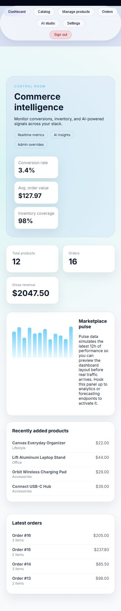

# eCommerce AI

A commerce operations prototype built with React, Express and SQLite. The running Node application connects catalog and inventory management, order inspection, dashboard totals and a transparent pricing sandbox. Separate Python examples explore embeddings, vector search, recommendations and forecasting.

## Project brief

[Read the three-page project brief (PDF)](output/pdf/E-Commerce-Project-Overview.pdf) · [Download PDF](https://github.com/mohamed6hani/E-Commerce-AI/raw/refs/heads/main/output/pdf/E-Commerce-Project-Overview.pdf) · [Demo walkthrough](docs/demo-guide.md) · [Architecture](docs/architecture.md) · [Portfolio case study](https://mohamedhaniramadan-portfolio.lovable.app/work/ecommerce-operations-prototype)



## Quick start

Use Node.js 22, npm and Python 3.10 or newer. From a fresh clone:

```sh
npm ci --prefix backend-mern
npm ci --prefix frontend-react
npm run build --prefix frontend-react
npm run init-db --prefix backend-mern
python tools/seed_demo_data.py
```

Copy `backend-mern/.env.example` to `backend-mern/.env`, then start:

```sh
npm start --prefix backend-mern
```

Open http://localhost:6220/dashboard. Without the optional `.env`, the server defaults to port 8800. It serves the React build and API together. Database initialization creates a new local SQLite file; no existing database is distributed.

The idempotent seed adds 12 products, 9 fictional accounts, 16 orders, 36 line items and 10 reviews, preserving existing rows and taking an initial backup. All demo addresses use `.example`.

## Scope

| Area | Current behavior |
| --- | --- |
| Catalog and inventory | Product listing, creation, editing and deletion |
| Orders | Create and inspect orders with linked line items |
| Dashboard | API-derived product/order counts and total order value |
| Pricing sandbox | Demand, stock and competitor inputs; previews a result |
| Interface | Responsive navigation and persistent light/dark preferences |
| Python examples | Separate embeddings, vector similarity, pricing and forecasting modules |

For the seeded smartwatch, demand `0.8` and competitor price `145` produce a suggested price of **154.80**. This is a documented rule, not a trained pricing model, and does not change the stored catalog price.

## Architecture

```text
frontend-react/      React operations interface
backend-mern/        Active Express API and SQLite store (historical folder name)
shared/              Separate Python AI examples
backend-fastapi/     Alternative Python backend example
backend-django/      Alternative Django backend example
tools/               Repeatable seed and isolated API smoke check
docs/                Architecture, walkthrough and demo screenshots
```

The active Node server uses SQLite rather than MongoDB. Dormant Mongoose model/config files remain as historical examples and are not imported by the running API. FastAPI and Django are separate experiments, not validated interchangeable backends for this UI.

## Validation

```sh
npm run build --prefix frontend-react
python tools/smoke_demo.py
```

The smoke check uses an isolated temporary project/database and validates clean initialization, repeatable seeding, foreign keys, order totals, pricing and product CRUD. CI runs the frontend build and this integration check. Python alternatives and model downloads are outside the validated Node demo.

## Development

For React's development server, run the backend on port **8800** (the frontend proxy) and `npm start --prefix frontend-react` in another terminal. Rebuild the frontend before returning to the combined server on port 6220.

## Current boundaries

This is a local prototype. Sign-in enters the dashboard without verifying the login API, passwords are plaintext, and routes do not enforce authorization. Complete customer checkout, payments and shipping are not implemented. Some analytics are placeholders; total order value is not settled payment revenue. The newest-product recommendation endpoint is not personalized or stock-aware. Python AI examples are not integrated into the running Node demo.

## History

This repository now contains eCommerce AI. The earlier academic analysis remains recoverable through Git history.
